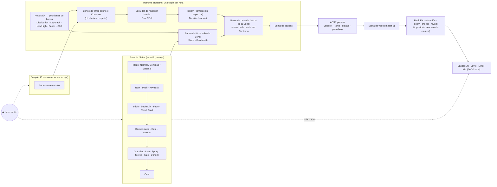

# Investigación: Color Play (Inorganic Audio · NEST Acoustics) y lo que puede aportar a Reanima (23-11-2026)

**Encargo:** investigar a fondo el plugin Color Play y valorar qué ideas aportarían a Reanima. Solo investigación: no se ha cambiado código, ni compilado, ni hecho commits.

> **Cómo leer este informe**
> - **[documentado]**: lo dice el fabricante (web oficial, guía de usuario, páginas de producto, correo de versión citado).
> - **[observado por usuarios]**: lo cuentan compradores en foros o reseñas. Es comportamiento real, pero de pocas personas y sin medidas.
> - **[hipótesis]**: deducción mía. El fabricante **no ha publicado** la arquitectura interna; nada marcado así debe tomarse como hecho.
> - Las secciones 6 a 9 son **interpretación y recomendación**, no hechos.
> - No he podido escuchar el plugin (no tiene versión de prueba) ni ver el vídeo: YouTube solo devolvió el título.

---

## Fuentes consultadas

| # | Fuente | Tipo | Qué aporta |
|---|---|---|---|
| F1 | [nestacoustics.com/colorplay](http://www.nestacoustics.com/colorplay) | Oficial (NEST) | Lista de funciones, requisitos, ejemplos «Signal + Contour» |
| F2 | [nestacoustics.com/colorplayuserguide](https://nestacoustics.com/colorplayuserguide) | **Oficial: guía de usuario** | La única descripción mando por mando. Base de casi todo el inventario |
| F3 | [inorganic.audio/color-play](https://inorganic.audio/color-play/) | Oficial (Inorganic Audio) | Funciones del motor (modos de distribución, formantes, 18 derivas, modo continuo, raíz por nombre), FAQ, licencia, versión 1.1.0 |
| F4 | [inorganic.audio](https://inorganic.audio/) y [ia-web-staging.pages.dev/color-play](https://ia-web-staging.pages.dev/color-play) | Oficial (copia de pruebas de la misma web) | Igual que F3 |
| F5 | [Rekkerd, 24-03-2026](https://rekkerd.org/nest-acoustics-releases-color-play-spectral-imprint-sampler/) | Prensa | Fecha, precio de lanzamiento, lista de funciones |
| F6 | [Plugin Boutique](https://www.pluginboutique.com/products/17058-Color-Play) | Tienda | Funciones, «latencia cero con el limitador desactivado», valoración 4,5/5 (15 votos; el texto de las reseñas no cargó) |
| F7 | [Hilo de KVR «NEST Acoustics Color Play»](https://www.kvraudio.com/forum/viewtopic.php?t=628258) y [página 2](https://www.kvraudio.com/forum/viewtopic.php?t=628258&start=15) | Foro (28 mensajes, feb–may 2026) | **Comportamiento real**: CPU, documentación, interfaz, impresiones, versión 1.1.0 |
| F8 | [Superbooth, ficha de Inorganic Audio](https://www.superbooth.com/en/messe-and-exhibitors/exhibitors/inorganic-audio.html) | Feria | Quién es el desarrollador; lo llama «sintetizador espectral» |
| F9 | [Vídeo en YouTube](https://www.youtube.com/watch?v=b0R_WW2QR1E) | Vídeo enlazado en KVR | Solo se pudo leer el título; sin descripción ni transcripción |
| — | [Hilo de Gearspace](https://gearspace.com/board/new-product-alert-2-older-threads/1461543-nest-acoutics-inorganic-audio-color-play.html) | Foro | **No accesible** (el servidor rechaza la lectura automática) |
| — | Canales [@InorganicAudio](https://www.youtube.com/@InorganicAudio) y [@nest.acoustics](https://www.youtube.com/@nest.acoustics) | Vídeo | **No accesibles** (página de consentimiento de cookies) |

**Lo que no existe o no he encontrado:**
- manual en PDF;
- historial de versiones publicado;
- entrevistas;
- reseñas en revistas (Sound On Sound, MusicTech, etc.);
- hilos en Reddit;
- fuentes en otros idiomas (busqué en japonés y alemán, sin resultados propios).

Los propios usuarios de KVR se quejan de esa falta de documentación (F7).

**Datos no verificados que he descartado:**
- un resumen de buscador hablaba de un «vocoder de 40 bandas» y de «dos capas de sample»; ninguna fuente primaria lo confirma;
- un comentario en un sitio de descargas ilegales sobre la CPU, que no cito.

---

## 1. Descripción y filosofía

### Qué es [documentado]
- **Nombre:** Color Play, «Spectral Imprint Sampler» (sampler de impronta espectral).
- **Autores:** NEST Acoustics (diseño de sonido y presets) junto con Inorganic Audio (desarrollador islandés; su otro producto es Liquid, un efecto granular).
- **Lanzamiento:** febrero de 2026. El hilo de KVR empieza el 26-02 y Rekkerd lo anuncia el 24-03 con precio de lanzamiento de 69 $ (normal 129 $).
- **Versión 1.1.0** (hacia mayo de 2026): modo «External» (entrada lateral) y AAX.
- **Formatos y sistemas:**
  - VST3, AU y AAX, en macOS e Intel/Apple Silicon y en Windows 10+ de 64 bits;
  - F1 dice macOS 10.14 y F3 dice 10.15: discrepancia sin resolver.
- **Licencia:** hasta 3 equipos, activación por internet con comprobación periódica.
- **Sin versión de prueba.**
- **Contenido:** «120 presets hechos a mano» (pads, synths, keys, plucks, bajos, FX) según F3, más «cientos» de grabaciones de campo y samples de instrumentos según F1.

### La idea central [documentado]
Color Play no mezcla dos sonidos: **imprime uno sobre otro**.

- La **Señal (Signal)**, en amarillo, es lo que suena.
- El **Contorno (Contour)**, en rosa, no se oye. Solo decide el **color**, es decir, cuánto deja pasar cada banda de frecuencia de la Señal.
- La Señal se divide en ventanas de frecuencia. El volumen de cada ventana sigue la amplitud de la misma ventana en el Contorno.
- Ese proceso se **clona para cada nota MIDI**: cada nota tiene su propio banco de filtros afinado a ella.

Ejemplos oficiales:
- un motor de barco como Señal, coloreado por una sierra sucia como Contorno;
- un synth simple como Señal, coloreado por unos carillones de viento.

En términos clásicos es un **vocoder de canales**, pero con tres diferencias:
1. **Es polifónico** y las bandas se colocan respecto a la nota tocada (octavas o armónicos), no solo en posiciones fijas.
2. **Los dos lados son samplers completos:** bucle, granular, deriva de afinación, inicio aleatorio.
3. **Está pensado para material no musical** (grabaciones de campo, foley) que se vuelve tocable.

### Filosofía [documentado + interpretación]
- **Lemas oficiales:** «belleza sin esfuerzo, posibilidades infinitas», «revela la música en cualquier sonido», «resultados inmediatos con control total».
- **[Observado por usuarios]:**
  - consigue resultados buenos muy rápido, sobre todo con los samples incluidos;
  - un usuario cree que el autor «lo hizo para sí mismo» y lo publicó porque sonaba bien.
- **[Interpretación]:** es un instrumento de **descubrimiento**, no de precisión. Pocos conceptos (dos samples, una impronta, una envolvente, una salida), mucho resultado, y documentación mínima.

---

## 2. Inventario de funciones

Todo lo de esta sección es **[documentado]**: F2 es la guía, F1 y F3 las webs oficiales. La guía casi nunca da rangos, unidades ni valores por defecto.

### 2.1 Zona de samplers: dos motores idénticos, Señal y Contorno

| Mando | Qué hace |
|---|---|
| **Mode** (modo de reproducción) | **Normal:** cada nota dispara una copia nueva del sample.<br>**Continuous:** la primera nota arranca una sola reproducción que sigue sonando pase lo que pase con las notas; recomendado para grabaciones de campo largas.<br>**External** (desde 1.1.0): el sampler se apaga y por él entra la señal lateral de la DAW; recomendado para voz o percusión en directo. Puede usarse en la fuente A, en la B o en ambas. |
| **Root** | Nota raíz del sample. F3 añade la detección automática por el nombre del archivo (p. ej. `Piano_C4.wav`). |
| **Pitch** | Semitonos y cents. |
| **Icono de teclado** | Activa o desactiva el seguimiento de teclado (keytracking): sirve para que un sample no cambie de altura con las notas. |
| **«S» (solo)** | Escuchar el sampler en seco, sin el procesado. |
| **Sample Start** | Punto de inicio. |
| **Líneas «L» y «R»** | Puntos de bucle. F3 habla de edición visual con precisión de muestra. |
| **Flechas de intercambio** | Intercambia los dos motores (Señal ↔ Contorno) con todos sus ajustes. Los usuarios lo valoran mucho. |

**Formatos de archivo:** WAV, AIFF y OGG según F3; un usuario añade MP3. Se cargan arrastrando. Un usuario cargó un archivo de 90 minutos sin encontrar límite (F7).

### 2.2 Controles de reproducción, en cada sampler

| Mando | Qué hace |
|---|---|
| **Loop** | Activa o desactiva el bucle. |
| **Fade** | Fundido cruzado entre el final y el reinicio del bucle. |
| **Rand. Start** | Cuánto se aleatoriza el punto de inicio en cada nota. |
| **Drift Mode** | Forma de la deriva de afinación. F3 habla de «18 algoritmos de deriva», desde un ligero temblor de cinta hasta una desafinación extrema; no se publican sus nombres. |
| **Rate** | Velocidad de la deriva. |
| **Amount** | Cuánto se desvía. |
| **Gain** | Volumen del sampler. |
| **Granular** (interruptor) | Lectura granular activada o desactivada. |
| **Scan** | Velocidad con que el cabezal granular recorre el sample. A 0 los granos se quedan quietos. |
| **Spray** | Dispersión aleatoria de la posición de los granos. |
| **Stereo** | Panorama aleatorio de cada grano. |
| **Size** | Duración del grano. |
| **Density** | Cuántos granos nacen por segundo. |

### 2.3 Spectral Imprint: «el corazón de Color Play»

| Mando | Qué hace |
|---|---|
| **Rise** | Velocidad con que cada banda sube hasta el nivel del Contorno. Alto: respuesta suave. Bajo: modulación a velocidad de audio, «parecida a una distorsión AM». |
| **Fall** | Velocidad con que cada banda baja. Alto: colas largas. Bajo: también AM. |
| **Bloom** | «Compresor espectral» que aplana el equilibrio armónico hacia un ruido blanco. Suele abrillantar el sonido y sacar detalle bajo. |
| **Low freq / High freq** | Límites de la banda más grave y la más aguda. Low freq se anula con Key track, porque entonces la banda más grave la fija la nota. |
| **Bands** | Resolución: cuántas ventanas. No se publica el número. |
| **Slope** | Pendiente de cada ventana. El valor «1» es la caída más suave y deja pasar más Señal. |
| **Bandwidth** | Anchura de cada ventana. Su escala depende de Bands y Distribution. |
| **Distribution** | **Logarithmic:** reparto tipo ecualizador, independiente de la nota.<br>**Octaves:** bandas en octavas desde la nota tocada.<br>**(Even) Harmonics:** bandas en la serie armónica desde la nota, fundamental incluida. F3 resume: el logarítmico sigue al oído, las octavas a los intervalos y los armónicos a los sobretonos. |
| **Key track** | Si el reparto sigue a la nota (en Logarithmic). Apagado, las bandas quedan fijas, como en un vocoder tradicional. |
| **Shift** | Desplaza las bandas graves o agudas. Sugerido para quitar las graves desplazando hacia arriba. |
| **Bias** | Inclinación: positivo favorece las bandas agudas y apaga las graves; negativo, al revés. |
| **Formant Shifting** (F3) | Desplaza el carácter vocal ±36 semitonos sin cambiar la altura. La guía no dice qué mando lo hace; **[hipótesis]** es el mismo Shift o un mando no documentado. |

### 2.4 Envolvente, por voz y después de la impronta

| Mando | Qué hace |
|---|---|
| **ADSR** | Envolvente de amplitud de cada voz. |
| **Velocity** | Cuánto afecta la fuerza de la nota a la amplitud, a la velocidad de ataque (más suave, ataque más lento) y a un filtro paso bajo. F1 lo llama «brillo». |

### 2.5 Salida

| Mando | Qué hace |
|---|---|
| **Lift** | Compresor ascendente de banda ancha, para subir el detalle. Indicado para foley y grabaciones de campo dinámicas. |
| **Level** | Ganancia de salida. |
| **Limit** | Techo de un limitador o compresor suave **sin anticipación** (latencia cero); con mucha señal se escapan picos. |
| **Mix** | Por debajo de 100 mezcla la Señal en seco. |

### 2.6 Otros

- **Rack de efectos:** saturación, delay, chorus y reverb (F1, F5, F6). La guía no los describe.
- **Polifonía:** F1 dice «hasta 8 voces independientes de impronta espectral afinada por MIDI». **[Hipótesis]:** es un límite de 8 notas simultáneas, cada una con su banco de filtros.
- **Modulación:** según un comprador (F7), solo hay la envolvente de amplitud, un LFO de afinación (probablemente la deriva) y la velocidad. No hay matriz, macros ni sincronía al tempo.

---

## 3. Esquema de funcionamiento (reconstrucción)

### 3.1 Flujo de señal

Las cajas siguen el orden que da la guía. Las etiquetas **(H)** marcan detalles internos que no están publicados: son **[hipótesis]**.



### 3.2 La impronta de una sola nota, en ASCII

```
        nota MIDI (p. ej. La2 = 110 Hz)
              │  Distribution = Harmonics, Bands = 8
              ▼
   centros: 110, 220, 330, 440, 550, 660, 770, 880 Hz   (+ Shift, Low/High, Bandwidth, Slope)

  SEÑAL ──► [BP 110][BP 220][BP 330] ... [BP 880]
              │       │       │            │
              × g1    × g2    × g3   ...   × g8   ──► Σ ──► ADSR ──► voz
              ▲       ▲       ▲            ▲
  CONTORNO ─► [BP 110][BP 220][BP 330] ... [BP 880]
              │       │       │            │
          seguidor (Rise/Fall) → Bloom (aplanar) → Bias (inclinar) → g1…g8
```

Lo que se deduce de este esquema:
- **[documentado]** Con Harmonics u Octaves, **un ruido (motor de barco, viento, lluvia) sale con la altura de la nota**: solo pasa por bandas centradas en sus armónicos. Por eso cualquier grabación se vuelve tocable.
- **[documentado]** Con Logarithmic y Key track apagado es un vocoder clásico de bandas fijas: el Contorno «habla» a través de la Señal.
- **[hipótesis]** «Filterbanks», «Slope», «Bandwidth» y la latencia cero apuntan a **filtros paso banda en el dominio del tiempo** (IIR), no a FFT. Encajaría con el coste de CPU del que se quejan: bandas × 2 (Señal y Contorno) × voces.
- **[hipótesis]** Si Rise/Fall bajan hasta frecuencias de audio, el seguidor deja de seguir la envolvente y sigue la onda. Eso es una modulación de anillo o AM por banda, que es la «distorsión AM» que describe la guía.

### 3.3 Qué mandos tocan cada etapa

| Etapa | Mandos | Efecto audible típico |
|---|---|---|
| Material | Mode, Root, Pitch, Keytrack, Start, L/R, Loop, Fade, Rand. Start, Gain | Qué se lee y cuándo |
| Movimiento del material | Drift (18 modos), Rate, Amount; Granular (Scan, Spray, Stereo, Size, Density) | Inestabilidad, nubes, congelación |
| Dónde están las bandas | Distribution, Key track, Bands, Low/High, Shift | Tonal (armónicos u octavas) frente a vocoder (logarítmico) |
| Forma de las bandas | Slope, Bandwidth | Resonante y silbante (estrecho) frente a suave y fiel a la Señal (ancho) |
| Cómo sigue el color | Rise, Fall | Suave y con colas frente a granuloso y AM |
| Equilibrio del color | Bloom, Bias | Brillo y detalle; inclinación grave o aguda |
| Nota | ADSR, Velocity | Articulación |
| Global | FX, Lift, Level, Limit, Mix | Acabado |

### 3.4 Combinaciones destacadas
1. **Ruido como Señal, sonido tonal como Contorno, en Harmonics:** ruido afinado que respira con el ritmo del Contorno (el ejemplo del barco con la sierra).
2. **Synth como Señal, sonido inarmónico como Contorno (carillones):** el synth adquiere la evolución espectral de los carillones.
3. **Contorno en Continuous con una grabación larga:** cada nota toma «el color de ese momento» de la grabación, que avanza sin parar.
4. **External en el Contorno:** vocoder en directo (voz o batería) sobre un sample.
5. **Granular con Scan a 0 en el Contorno:** color congelado, una especie de filtro dibujado por un instante del sample.
6. **Rise/Fall muy rápidos:** texturas sucias, de anillo o AM.
7. **Intercambio ⇄:** con dos samples se prueban rápidamente las dos direcciones.

---

## 4. Fortalezas, límites y rasgos diferenciales

### Fortalezas
- **[observado por usuarios]**
  - Resultados buenos muy rápido.
  - Variedad grande incluso con solo dos sonidos.
  - Las secciones Señal/Contorno están «muy bien pensadas».
  - El intercambio ⇄ es «genial».
  - Muy bueno en pads ambientales y teclados raros.
  - Los FX internos suenan dignos.
  - Ningún comprador del hilo reporta cuelgues.
- **[documentado]**
  - Latencia cero.
  - Funciona con cualquier sample y con audio en directo.
  - Admite archivos larguísimos.

### Límites e inconvenientes [observado por usuarios]

Todo viene de F7, salvo donde se indica.

- **CPU alta e irregular:** es la queja principal. Curiosamente gasta *más* con el granular apagado. Según el usuario, el desarrollador dijo que estaba optimizando (dato de segunda mano).
- **Sin documentación real.** Los nombres de los mandos espectrales son opacos («no está claro qué hacen los mandos centrales»).
- **Algunos parámetros «aparecen de golpe»** a niveles intensos: falta de suavizado o curvas mal repartidas.
- **Pocos moduladores**, y no se sincronizan al tempo: los usuarios piden sincronía para los granos y el LFO.
- **La ventana no se puede redimensionar:** demasiado pequeña en 4K.
- **Sin versión de prueba**, y precio considerado alto.
- Un comprador tuvo problemas con el soporte.
- Algunos desconfían por la trayectoria de otros productos de NEST (la serie Morphology se paró y hubo inestabilidad en Delta). No es un dato sobre Color Play.
- **Comparaciones:** «básicamente un vocoder»; algunos dicen que se acerca con convolución cruzada más vocoder de fase, con Serum 2 (modo espectral y warp vocoder), con Icarus 3 o con Vocalsynth. Otro dice que se parece a Dawesome Novum pero tiene identidad propia.

### Rasgos diferenciales [interpretación]
1. **El vocoder convertido en sampler polifónico afinado:** bandas por nota y repartidas en armónicos u octavas. Es lo que lo separa de un vocoder de efecto.
2. **Los dos lados son samplers con movimiento propio** (granular, deriva, continuo), así que el color también evoluciona.
3. **Interfaz mínima, con el foco en elegir parejas de sonidos.**

---

## 5. Casos de uso y ejemplos

**[Documentados o de usuarios]:**
- pads ambientales a partir de grabaciones de campo;
- teclados y plucks raros;
- bajos y FX (las categorías de los presets);
- vocoder de voz o batería en directo (External);
- dar textura a cualquier instrumento («bring texture to any instrument»).

**[Interpretación]: usos de producción que se deducen del diseño:**
- **Diseño sonoro para imagen:** el ruido de una máquina «afinado» a la tonalidad de la escena.
- **Puentes entre lo orgánico y lo sintético:** un synth básico que respira como el viento.
- **Ritmo desde un sample tonal:** con un loop de batería como Contorno, un pad se vuelve rítmico (efecto de puerta espectral).
- **Capa de «aire» con altura:** ruido rosa como Señal y una voz como Contorno, en Harmonics, da un coro susurrado afinado.

---

## 6. Ideas para Reanima (interpretación)

### 6.1 Lo que Reanima ya tiene y conviene recordar
Lo leído en el código (`Source/Params.cpp`, `Source/SynthEngine.h`, `Source/SampleAnalysis.h`) y en `docs/`:

**Un solo sample, por decisión del 13-11.** Color Play se basa en *dos*. Ninguna propuesta de abajo cambia esa identidad: el «Contorno» saldría del propio sample, de la entrada lateral o de curvas internas.

**Lo que ya equivale a algo de Color Play:**

| En Reanima | Equivale en Color Play a… |
|---|---|
| Granular (motor E y modo sustain Granular de B/D): Posición, Densidad, Grano, Spray, Ancho de granos, Deriva, Pitch aleatorio, Al revés, opción Coherente | Su granular, y más completo |
| Inicio, Fin, Bucle, Cruce, Fundidos, Reverse | Start, L/R, Loop, Fade |
| Variación (cada nota un poco distinta en afinación, volumen y brillo), Vibrato, LFO con S&H, fuente «Aleatorio» de la matriz | Una parte de la deriva y de Rand. Start: Aleatorio → Inicio ya es posible en la matriz |
| Fuerza → brillo, Vel → Amp, Golpe | Su Velocity |
| Matriz de 8 ranuras, 3 LFO con sincronía, Env 2, 4 macros con doble aro | **Muy por encima** de Color Play, que es justo lo que le reprochan sus usuarios |
| Compresor con modo ascendente multibanda en el rack de FX | Lift |
| Escenario maestro con techo suave | Limit |
| Rack tipo Serum con buses, filtros por voz (Vowel, Comb, Morph…) | Más que su rack |
| Desplazador de frecuencia (Bode) | — |
| **Análisis espectral ya calculado al cargar** | Color Play lo calcula en tiempo real. Reanima tiene:<br>• el ruido del motor C en **24 bandas por cuadro** (`PartialModel::noise`, cada 256 muestras);<br>• los parciales con amplitud y frecuencia por cuadro;<br>• el color del ataque en 7 bandas (`Excitation::attackColour`);<br>• la envolvente RMS (`env`). |
| **Entrada lateral** (bus auxiliar «Sidechain», 22-11) | Su modo External. En Reanima **solo se usa para detectar la tonalidad y el acorde** (`KeyDetect::AudioStream`): la infraestructura de entrada existe, pero el audio no llega al sonido. |
| Motor F: «Filtro dibujado» de 16 puntos y Armónicos | Un «color» estático dibujado a mano y una impronta armónica sobre ruido espectral |

### 6.2 Por tema

**Timbre y contenido armónico.**
- La idea más valiosa de Color Play es el **reparto de bandas por armónicos de la nota**: convierte cualquier ruido en algo tonal *sin* resíntesis.
- En Reanima, los samples no tonales (el 71 % de la biblioteca son loops, más texturas y FX) hoy solo se vuelven tonales con:
  - el motor F (Armónicos);
  - el filtro Comb;
  - Warp Tonos (que cae a Textura en mucho material).
- Un **banco armónico por voz** (resonadores en n·f0 con anchura, pendiente e inclinación) daría un camino nuevo, barato y predecible.

**Resíntesis y remodelado.**
- El motor C ya *es* una impronta posible: puede tomar la amplitud de sus parciales y bandas de ruido de **otro momento del mismo sample**, o de una curva.
- B y D sostienen la nota con un bucle o un freeze **ecualizado y estático** (`SustainSource`). Reimprimirles la evolución espectral del original (sus 24 bandas por cuadro) devolvería el movimiento natural que el sostenido pierde. Es una mejora de **fidelidad**, no solo de efecto.

**Modulación y movimiento.**
- De Color Play se aprende sobre todo el **«color en movimiento»**: el filtro no es fijo, se mueve con otro sonido.
- Reanima puede hacerlo con su propio sample: la evolución espectral del sample como *fuente de modulación* (una curva de color que avanza, se estira o se congela).
- Sus 18 derivas indican que la **inestabilidad orgánica** vende. Reanima solo tiene S&H y aleatorio por nota; le falta una **deriva suave** (ruido 1/f, lloro de cinta).

**Sonidos tonales.**
- Shift aplicado al Contorno equivale a un **desplazamiento de formantes** sin coste extra: mover el mapa de bandas respecto a la nota.
- Encaja con el desplazador de formantes P1(b), pendiente en la hoja de ruta.

**Evolución temporal y dinámica.**
- **Continuo:** una sola lectura global que todas las notas comparten. Da acordes coherentes en E y F con grabaciones largas: cada nota es el mismo paisaje afinado distinto, no copias desfasadas.
- **Rise/Fall:** dos mandos muy claros para «cómo de pegado sigue el color».

**Macros.**
- Color Play no tiene. Si se añade un módulo de impronta, merece **3 o 4 mandos con buen recorrido** y estar disponible como destino de la matriz: Cantidad, Rise/Fall, Inclinación, Desplazar.

**Interfaz y flujo de trabajo.**
- **Lo que hace bien:**
  - el botón «S» para oír la fuente sin procesar (Reanima ya tiene el «Escuchar» de Mecanismo; la idea podría generalizarse);
  - el intercambio ⇄ en un clic;
  - pocos conceptos con nombres de color.
- **Lo que hace mal y Reanima ya evita:**
  - sin manual (Reanima tiene guías por pestaña y textos de ayuda);
  - sin escalado de ventana;
  - mandos que saltan.

### 6.3 Por motor

| Motor | Qué encaja | Valor | Riesgo |
|---|---|---|---|
| **A · Reconstrucción** | Solo como módulo opcional **después** de la voz (banco armónico o impronta lateral) | Medio: A es «el archivo tal cual» | Romper «sin tocar = archivo original» (nulo de 131 dB) si no queda apagado por defecto |
| **B · Reenvolvente / D · Híbrido** | Reimprimir la evolución espectral original sobre el sostenido (Loop, Granular o Freeze) | **Alto (fidelidad):** el sostenido deja de sonar «parado» | Bajo-medio: hay que igualar niveles y no tocar el transitorio original de D |
| **C · Resíntesis** | «Color de…»: amplitudes de parciales y ruido leídas de otra posición o velocidad del sample, o de la entrada lateral; Shift de formantes desplazando el mapa | Alto y **barato**: C ya trabaja por bandas y parciales | Bajo: es un cambio en la lectura del modelo |
| **E · Granular** | Lectura **continua global** (todas las notas leen el mismo cabezal); deriva suave; color en movimiento sobre la nube | Medio-alto en texturas y acordes | Que Coherente y Continuo choquen; hay que definir prioridades |
| **F · Drone Maker** | Animar el «Filtro dibujado» con la curva de color del propio sample (o con la entrada lateral); reparto de Armónicos ya cercano | Alto: F ya es espectral (FFT) y aplicar ganancias por banda casi no cuesta | Bajo; F es el motor más caro (≈ 22 ms/s por voz), pero esto no lo encarece |
| **LOOP / SLICE** | Contorno rítmico: la envolvente por bandas del loop como modulación de un pad (puerta espectral) | Medio | Diseño de interfaz |
| **Filtro por voz** | Nuevo tipo «Armónico» (banco de resonadores en n·f0) | **Alto** y disponible en los seis motores | CPU por voz: hay que limitar bandas |
| **Rack FX** | Nuevo módulo «Impronta» global con la entrada lateral (vocoder de bandas fijas) | Medio-alto: usa la entrada lateral, hoy muda | Bajo |
| **Matriz** | Fuente «Color» (energía de una banda o del centroide del sample en el punto de lectura) y forma de LFO «Deriva» | Medio | Muy bajo |

---

## 7. Propuestas concretas

Las numero **CP1…CP9**. Ninguna está implementada; el orden es mi recomendación de valor y riesgo.

### CP1 · Filtro por voz «Armónico» (banco afinado a la nota)
- **Módulo:** filtro por voz (`fltType`), nueva opción. Funciona en los seis motores.
- **Qué hace:** de 8 a 32 resonadores paso banda en los armónicos de la nota (o en octavas, como segunda opción), con estos mandos:
  - Frecuencia, que hace de «hasta dónde» (High freq);
  - Resonancia, que hace de anchura (Bandwidth/Slope);
  - Morph, que hace de inclinación (Bias);
  - Drive y Dry/Wet, ya existentes.
- **Para qué:** afinar ruidos, loops, grabaciones de campo y percusión **sin** resíntesis ni Warp. Es lo más «Color Play» que se puede hacer con un solo sample.
- **Ventaja:** reutiliza parámetros existentes; no hacen falta parámetros nuevos o bastan uno o dos.

### CP2 · «Impronta lateral»: la entrada lateral colorea el sonido
- **Módulo:** nuevo tipo en el rack de FX (Main o Bus), con la entrada auxiliar que ya existe.
- **Fase 1, global:** bandas fijas logarítmicas (vocoder clásico) con Cantidad, Rise, Fall, Bandas, Inclinación y Desplazar.
- **Fase 2, opcional:** por voz, con reparto armónico; mucho más caro.
- **Botón ⇄ «Invertir papeles»:** que el sample sea el color y la entrada lateral lo que suena. Reanima, con su sample, «pinta» una batería o una voz de la pista de al lado.
- **Para qué:** voz o batería en directo que hacen hablar o latir al instrumento. Hoy la entrada lateral solo sirve para la tonalidad.

### CP3 · Sostenido B/D con la evolución espectral del original
- **Módulo:** motores B y D (`SustainSource` y su lectura).
- **Qué hace:** aplicar al bucle o freeze del sostenido las ganancias por banda que el sample original tenía en cada momento, ya calculadas (24 bandas del modelo de ruido o una pista nueva de 24–32 bandas creada al cargar).
- **Mando:** «Movimiento original» de 0 a 1, o automático al 100 % si se aprueba de oído.
- **Para qué:** fidelidad. El sostenido deja de ser una foto fija y sigue el apagamiento y brillo naturales.
- **Validación:** con los bancos existentes (`ReanimaBatch calidad`, `motores_tonal`) y A/B de volumen igualado.

### CP4 · Motor C, «Color de»: impronta desde otro momento del mismo sample
- **Módulo:** motor C (lectura de `PartialModel`).
- **Qué hace:** las frecuencias de los parciales siguen la lectura normal, pero sus amplitudes y el ruido se toman de otra posición o velocidad del mismo sample:
  - el color del ataque congelado sobre toda la nota;
  - el color del final al principio;
  - el color de un loop rítmico sobre un sonido tenido.
- Lleva un **Desplazar** que mueve el mapa de color respecto a los parciales: desplazamiento de formantes sin coste.
- **Mandos:** Posición de color, Velocidad de color (0 = congelado), Desplazar formantes, Cantidad.

### CP5 · Motor F, «Filtro dibujado» animado
- **Módulo:** motor F.
- **Qué hace:** además de la curva de 16 puntos fija, una opción para que la curva **siga la evolución espectral del propio sample** (o de la entrada lateral), con Rise/Fall.
- **Para qué:** el drone respira con la forma del sample original en lugar de quedar plano.
- **Coste:** F ya trabaja en FFT; aplicar ganancias por banda es casi gratis.

### CP6 · Lectura «Continua» en E y F
- **Módulo:** motores E y F (posición de lectura).
- **Qué hace:** un interruptor «Continuo». La primera nota arranca un cabezal global; las notas siguientes leen desde ese mismo cabezal (afinadas cada una), en vez de empezar cada una en Posición. El cabezal sigue avanzando con Deriva.
- **Para qué:** acordes coherentes con grabaciones largas; texturas que «siguen» mientras se toca.
- **Relación:** recuerda a «Play con el host» del LOOP, pero sin transporte.

### CP7 · Forma de LFO «Deriva» (aleatorio suave)
- **Módulo:** LFO (`lfoShapes`).
- **Qué hace:** una sexta forma más, ruido suave tipo 1/f o lloro de cinta, interpolado (no a saltos como S&H).
- **Para qué:** la inestabilidad orgánica que vende Color Play (sus «18 derivas»), con **una** forma bien hecha y la matriz existente.
- **Coste:** prácticamente nulo.

### CP8 · Fuente de modulación «Color del sample»
- **Módulo:** matriz (`sources`).
- **Qué hace:** una fuente que da el brillo (centroide) o el nivel de una banda del sample en el punto de lectura de la voz, ya analizado.
- **Para qué:** que el propio sample module el filtro, el pan o los granos. Es un «Contorno» interno sin segundo sample.

### CP9 · Pequeñas mejoras de flujo de trabajo
- **Raíz por nombre del archivo como pista** cuando la detección no está segura (`Piano_C4.wav`). Reanima ya usa el nombre para el tempo y el Mecanismo. Ojo: VSCO nombra las octavas una más baja, como se vio el 13-11, así que solo como pista.
- **«Vel → ataque»:** que tocar suave alargue el ataque. Color Play lo tiene; Reanima tiene Golpe y Fuerza → brillo, pero no esto.
- **Botón de escucha en seco** generalizado (como «S»): oír el sample sin el módulo nuevo, para comparar.
- **Sincronía al tempo de la densidad granular:** los usuarios de Color Play la piden y Reanima no la tiene en E. Es opcional.

---

## 8. Dificultad, dependencias, riesgos y rendimiento

Estimaciones **[hipótesis]** a partir del código actual y de las medidas de `docs/auditoria_motores_2026-11-22.md` (CPU por voz a 48 kHz: A ≈ 4, B/D ≈ 10–15, C ≈ 10, E ≈ 6, F ≈ 22 ms/s).

| Propuesta | Dificultad | Depende de | CPU estimada | Riesgos principales |
|---|---|---|---|---|
| CP1 Filtro «Armónico» | Media | Filtro por voz (`Filters.h`), seguimiento de nota | +3 a +10 ms/s por voz con 16–32 bandas estéreo; con 32 voces y todo, puede desbordar a 96 kHz | Resonancias muy estrechas pueden silbar o saturar: hace falta normalizar la ganancia por número de bandas; el nivel debe medirse con `auditar_presets.py` |
| CP2 Impronta lateral (global) | Media | Bus auxiliar ya existente, rack de FX | Baja (una instancia: 2 × N bandas) | Ableton: el panel Sidechain ya está; en el Standalone no hay entrada lateral; la latencia debe seguir en cero |
| CP2 por voz | Alta | CP2 global | Alta (bandas × voces) | Es justo la queja de CPU de Color Play: no recomiendo empezar por aquí |
| CP3 Sostenido B/D | Media | Análisis al cargar (más memoria por sample), `SustainSource` | Muy baja (ganancias por banda, quizá con un banco de filtros o una FFT ya existentes) | Cambia el sonido de B/D: obliga a A/B de oído; no debe tocar el transitorio de D |
| CP4 Motor C «Color de» | Baja-media | `PartialModel` | Casi nula | Que la mezcla de colores de momentos distintos suene «hueca» en sonidos muy cambiantes |
| CP5 F animado | Baja | Filtro dibujado de F, análisis por bandas | Casi nula | Que el drone pierda su calma (hace falta Rise/Fall lento por defecto) |
| CP6 Continuo E/F | Media | Lectura de E/F, gestión de voces | Ninguna | Interacción con Coherente, robo de voces y presets; definir qué pasa al soltar todas las notas |
| CP7 LFO «Deriva» | Muy baja | LFO | Nula | Ninguno relevante (cambia la lista de formas: hay que cuidar la compatibilidad de proyectos añadiéndola al final) |
| CP8 Fuente «Color» | Baja | Matriz, análisis | Nula | Ninguno relevante |
| CP9 | Baja | — | Nula | Raíz por nombre: errores de octava de algunos fabricantes |

**Riesgos transversales:**
- **Compatibilidad:** las opciones nuevas en listas existentes (tipo de filtro, forma de LFO, fuentes) van siempre al final, para no cambiar proyectos ni presets guardados.
- **Calidad:** las reglas de las auditorías anteriores siguen vigentes:
  - sin asignaciones en el hilo de audio (`RtCheck`);
  - sin clics;
  - independencia del tamaño de bloque;
  - latencia cero;
  - aliasing bajo −98 dB donde aplique.
  - Rise/Fall muy rápidos (la «AM» de Color Play) generan productos de modulación y deben quedar acotados.
- **Suavizado:** los usuarios de Color Play se quejan de mandos que «saltan». Todo mando nuevo necesita rampas y una curva repartida con la escala de la ayuda (centro en el valor útil).
- **Identidad:** nada de esto convierte a Reanima en un sampler de dos samples. El «Contorno» sale siempre del propio sample, de la entrada lateral o de una curva.
- **Validación:** como en cada fase anterior: medidas antes y después en los bancos, CPU con `ReanimaCpuBench`, y **se queda solo lo que apruebes de oído**.

---

## 9. Lo que no recomiendo incorporar

1. **Un segundo sample (arquitectura Señal + Contorno).** Choca con la decisión del 13-11 («un sample, el mejor»):
   - duplica memoria y análisis;
   - complica toda la interfaz;
   - convierte a Reanima en otro producto.
   
   Lo que aporta se consigue con CP2, CP3, CP4 y CP8 sin un segundo archivo.
2. **Bancos de filtros por voz en tiempo real como base del sonido**, con muchas bandas en las 32 voces. Es la principal queja de Color Play (CPU alta e irregular) y Reanima tiene ventaja: su análisis espectral ya está hecho al cargar.
3. **Copiar los «18 algoritmos de deriva».** Es una cifra de marketing. Una buena forma de LFO (CP7) más la matriz cubre lo mismo con menos mandos.
4. **La «distorsión AM» de Rise/Fall rapidísimos como comportamiento normal.** Produce aliasing y suciedad difíciles de controlar. Como mucho, un extremo del recorrido claramente señalado.
5. **Una biblioteca grande de grabaciones de campo incluida.** Pesa, plantea problemas de licencia (ya hubo aviso con el sample de demo) y no hace falta: el material es el sample del usuario.
6. **Copiar la interfaz** (el código amarillo/rosa, los nombres Signal/Contour, el aspecto). Reanima tiene sus colores de módulo (`docs/colores_modulos.md`) y su propio vocabulario. Si se adoptan las ideas, con nombres propios en español: «Color», «Impronta», «Armónico», «Continuo».
7. **Activar la impronta por defecto en el motor A.** Rompería la garantía «sin tocar = archivo original». Todo debe quedar apagado o a cero por defecto.
8. **Su modelo de documentación y de producto** (sin manual, sin escalado, sin prueba). Es lo contrario de lo que Reanima ya hace bien: guías por pestaña, ayuda en cada mando y escala de interfaz.

---

## Resumen de hechos frente a recomendaciones

- **Hechos verificados:**
  - qué es Color Play y sus mandos: sección 2, de la guía oficial F2;
  - sus formatos, precio y versión: F1, F3, F5 y F7;
  - las impresiones de los compradores: F7, sección 4, de pocas personas y sin medidas.
- **Hipótesis:**
  - que use filtros IIR en el tiempo;
  - el orden exacto del rack de FX;
  - que «8 voces» sea el límite de polifonía;
  - cómo hace el desplazamiento de formantes.
- **Recomendaciones (secciones 6–9):** son mías. Por valor y riesgo, empezaría por **CP1** (filtro Armónico), **CP3** (sostenido B/D con movimiento original), **CP7** (LFO Deriva) y **CP2 global** (impronta con la entrada lateral). Todas necesitan tu decisión y una prueba de oído antes de quedarse.
